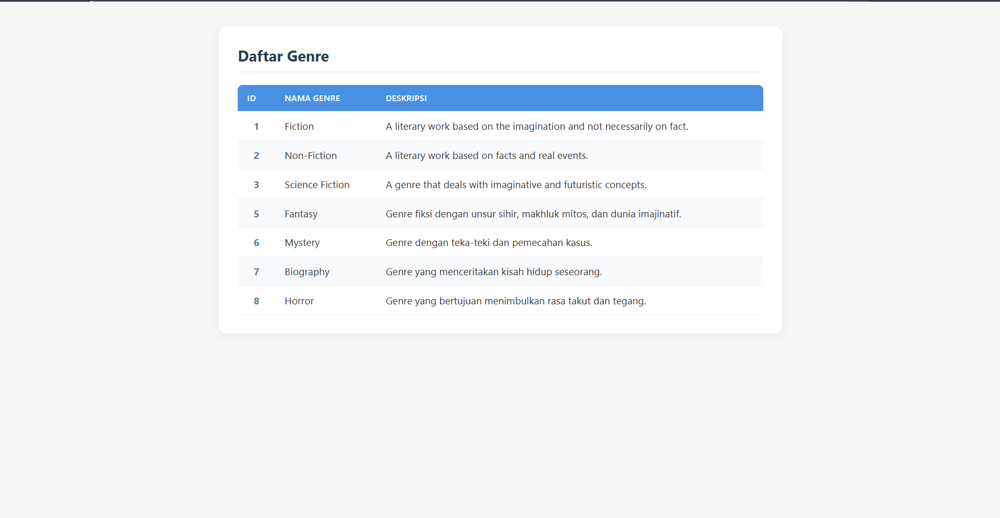

# Booksales API - Tugas Pertemuan 1 (Sistem MVC Laravel)

Proyek ini dibuat untuk memenuhi tugas implementasi sistem MVC (Model-View-Controller) sederhana pada framework Laravel 12 dengan studi kasus data **Genre** dan **Author**.

---

## Struktur File & Perubahan

Berikut adalah daftar file yang ditambahkan dan disesuaikan dalam tugas ini:

### 1. Model
* `app/Models/Genre.php` — Menyimpan data statis array untuk tabel Genre (ID, Name, Description).
* `app/Models/Author.php` — Menyimpan data statis array untuk tabel Author (ID, Name, Photo, Bio).

### 2. Controller
* `app/Http/Controllers/GenreController.php` — Mengambil data dari `Genre` Model dan mengirimkannya ke View `genres.index`.
* `app/Http/Controllers/AuthorController.php` — Mengambil data dari `Author` Model dan mengirimkannya ke View `authors.index`.

### 3. View
* `resources/views/genres/index.blade.php` — Menampilkan tabel daftar genre dengan styling CSS.
* `resources/views/authors/index.blade.php` — Menampilkan tabel daftar author dengan styling CSS.

### 4. Routing
* `routes/web.php` — Mendaftarkan rute `/genres` dan `/authors`.

---

## 📸 Tampilan Aplikasi

### 1. Daftar Genre (`/genres`)

### 2. Daftar Author (`/authors`)

---
