# Booksales API - Tugas Show, Update & Destroy Data (REST API Laravel)

Proyek ini merupakan pengembangan lanjutan dari layanan **REST API** Laravel. Pada tahap ini ditambahkan fitur **Show** (membaca satu data), **Update** (memperbarui data), dan **Destroy** (menghapus data) untuk sumber daya **Genre** dan **Author**, lengkap dengan penanganan data yang tidak ditemukan (`404`) dan penyederhanaan rute menggunakan **`apiResource`**.

---

## 🚀 Perubahan & Struktur API

Berikut adalah penyesuaian utama pada tahap ini:

1. ### Routing API (Route API Resource)
   - `routes/api.php` — Rute manual `GET` dan `POST` untuk genre dan author diganti dengan `Route::apiResource()`, sehingga satu baris otomatis membuat lima rute (`index`, `store`, `show`, `update`, `destroy`).

   Sebelum:
   ```php
   Route::get('/genres', [GenreController::class, 'index']);
   Route::post('/genres', [GenreController::class, 'store']);
   ```

   Sesudah:
   ```php
   Route::apiResource('/genres', GenreController::class);
   Route::apiResource('/authors', AuthorController::class);
   ```

2. ### Controller (JSON Output)
   - `app/Http/Controllers/GenreController.php` — Menambahkan method `show()`, `update()`, dan `destroy()`.
   - `app/Http/Controllers/AuthorController.php` — Menambahkan method `show()`, `update()`, dan `destroy()`.

3. ### Penanganan Data Tidak Ditemukan
   - Setiap method yang menerima `{id}` (`show`, `update`, `destroy`) mencari data dengan `find()`. Jika data tidak ada, API mengembalikan respons JSON dengan status code `404 Not Found`.

---

## 📌 Endpoints API

| Method | Endpoint | Deskripsi | Status Code |
| :--- | :--- | :--- | :--- |
| `GET` | `/api/genres` | Mengambil seluruh data genre | `200 OK` |
| `POST` | `/api/genres` | Menambahkan data genre baru | `201 Created` / `422` |
| `GET` | `/api/genres/{id}` | Mengambil satu data genre | `200 OK` / `404` |
| `PUT` / `PATCH` | `/api/genres/{id}` | Memperbarui data genre | `200 OK` / `404` / `422` |
| `DELETE` | `/api/genres/{id}` | Menghapus data genre | `200 OK` / `404` |
| `GET` | `/api/authors` | Mengambil seluruh data penulis | `200 OK` |
| `POST` | `/api/authors` | Menambahkan data penulis baru | `201 Created` / `422` |
| `GET` | `/api/authors/{id}` | Mengambil satu data penulis | `200 OK` / `404` |
| `PUT` / `PATCH` | `/api/authors/{id}` | Memperbarui data penulis | `200 OK` / `404` / `422` |
| `DELETE` | `/api/authors/{id}` | Menghapus data penulis | `200 OK` / `404` |
| `GET` | `/api/books` | Mengambil seluruh data buku beserta data penulisnya | `200 OK` |

### Aturan Validasi (POST & PUT)

| Endpoint | Field | Aturan |
| :--- | :--- | :--- |
| `/api/genres` | `name` | `required`, string, maksimal 255 karakter |
| `/api/genres` | `description` | `nullable`, string |
| `/api/authors` | `name` | `required`, string, maksimal 255 karakter |
| `/api/authors` | `photo` | `nullable`, string, maksimal 255 karakter |
| `/api/authors` | `bio` | `nullable`, string |

> **Catatan:** Tambahkan header `Accept: application/json` pada setiap request agar respons validasi yang gagal berupa JSON (`422`), bukan redirect.

### Format Output JSON

**Show data (`200 OK`)** — `GET /api/genres/1`

```json
{
  "status": "success",
  "message": "Berhasil mengambil detail data genre",
  "data": {
    "id": 1,
    "name": "Fiction",
    "description": "A literary work based on the imagination and not necessarily on fact.",
    "created_at": "2026-10-27T11:43:50.000000Z",
    "updated_at": "2026-10-27T11:43:50.000000Z"
  }
}
```

**Update data (`200 OK`)** — `PUT /api/authors/6`

Request body:

```json
{
  "name": "Raditya Dika",
  "photo": "radit-baru.jpg",
  "bio": "Penulis, komedian, dan sutradara."
}
```

Respons:

```json
{
  "status": "success",
  "message": "Berhasil mengubah data author",
  "data": {
    "id": 6,
    "name": "Raditya Dika",
    "photo": "radit-baru.jpg",
    "bio": "Penulis, komedian, dan sutradara.",
    "created_at": "2026-10-29T04:15:12.000000Z",
    "updated_at": "2026-10-30T03:27:23.000000Z"
  }
}
```

**Destroy data (`200 OK`)** — `DELETE /api/genres/6`

```json
{
  "status": "success",
  "message": "Berhasil menghapus data genre"
}
```

**Data tidak ditemukan (`404 Not Found`)** — misalnya `GET /api/authors/99`

```json
{
  "status": "error",
  "message": "Data author tidak ditemukan"
}
```

**Validasi gagal (`422`)** — misalnya `PUT` tanpa field `name`

```json
{
  "message": "The name field is required.",
  "errors": {
    "name": ["The name field is required."]
  }
}
```

---

## ⚙️ Cara Menjalankan

```bash
composer install
cp .env.example .env
php artisan key:generate
# sesuaikan DB_DATABASE (db_penjualan_buku), DB_USERNAME, dan DB_PASSWORD di file .env
php artisan migrate:fresh --seed
php artisan serve
```

API dapat diakses di `http://127.0.0.1:8000/api`.

---

## 📸 Pengujian dengan Postman

### Genre

#### 1. Show Genre (`GET /api/genres/1`) — `200 OK`
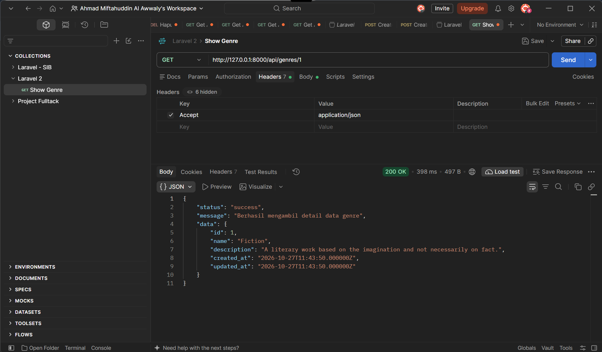

#### 2. Show Genre tidak ditemukan (`GET /api/genres/99`) — `404 Not Found`
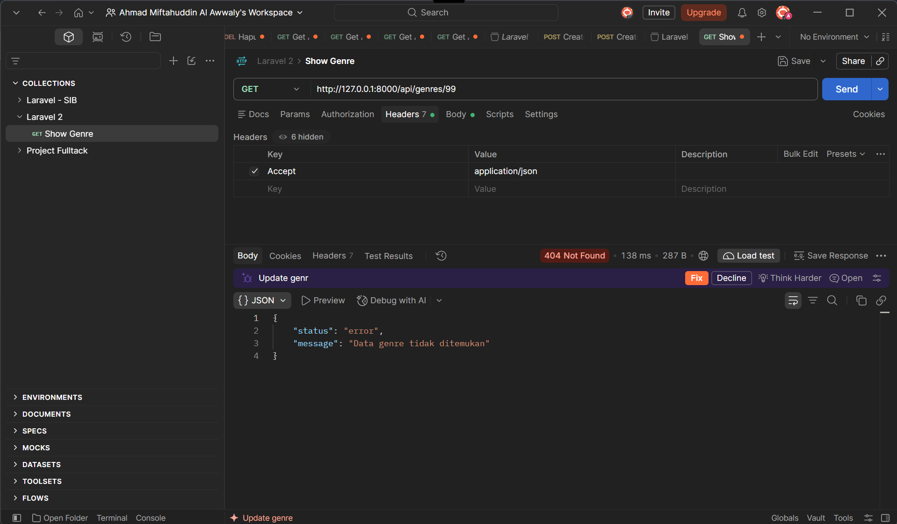

#### 3. Update Genre (`PUT /api/genres/6`) — `200 OK`
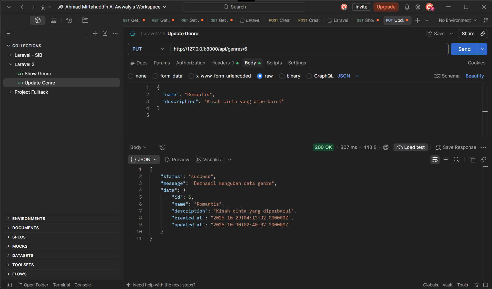

#### 4. Update Genre tanpa `name` (`PUT /api/genres/6`) — `422`
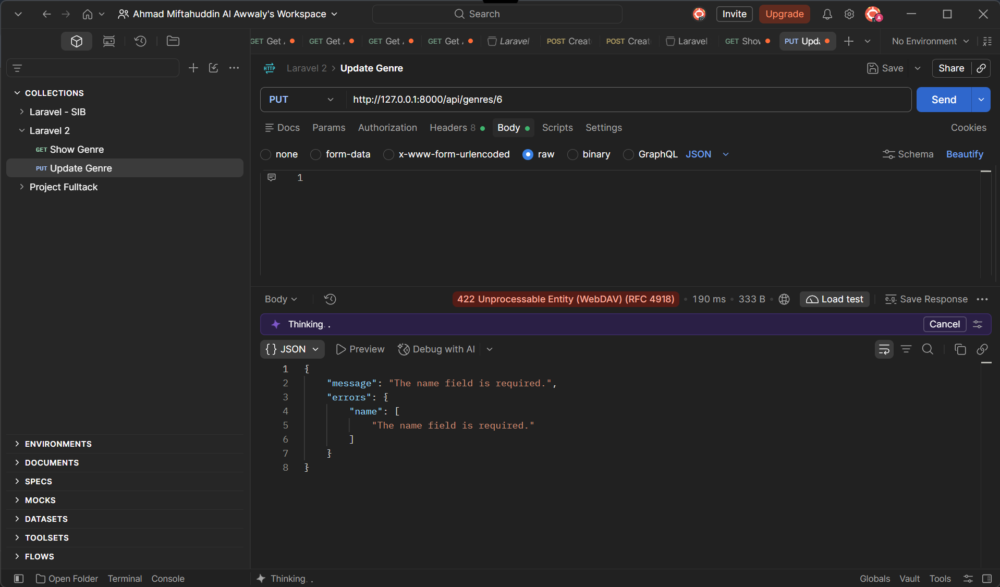

#### 5. Update Genre tidak ditemukan (`PUT /api/genres/99`) — `404 Not Found`
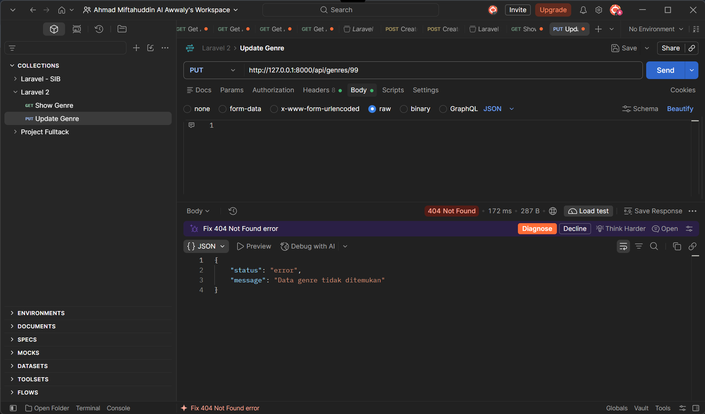

#### 6. Destroy Genre (`DELETE /api/genres/6`) — `200 OK`
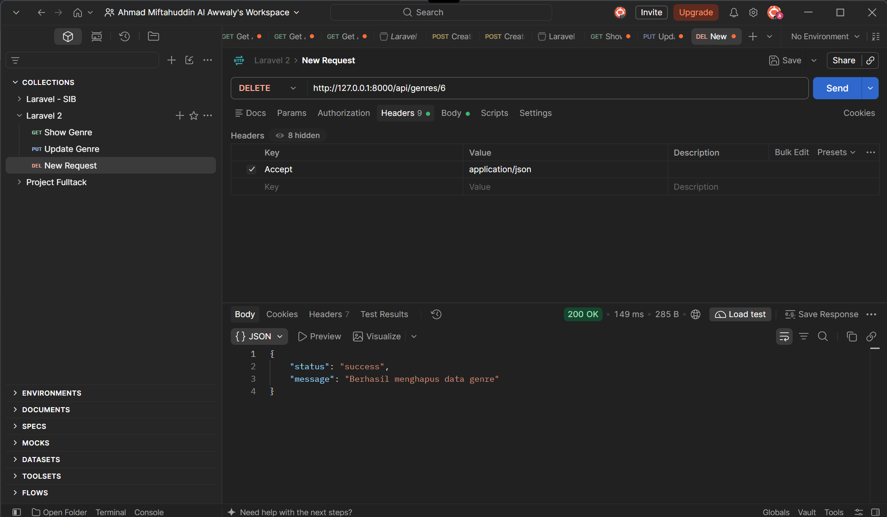

#### 7. Destroy Genre yang sudah dihapus (`DELETE /api/genres/6`) — `404 Not Found`
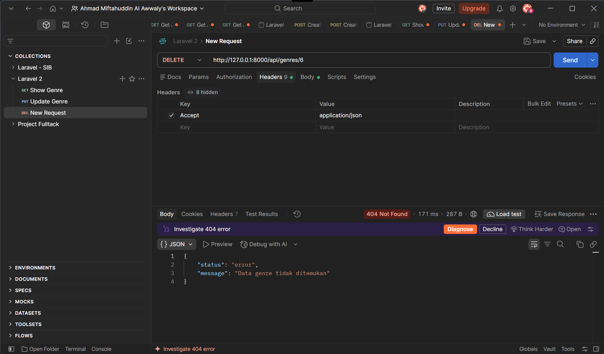

### Author

#### 1. Show Author (`GET /api/authors/1`) — `200 OK`
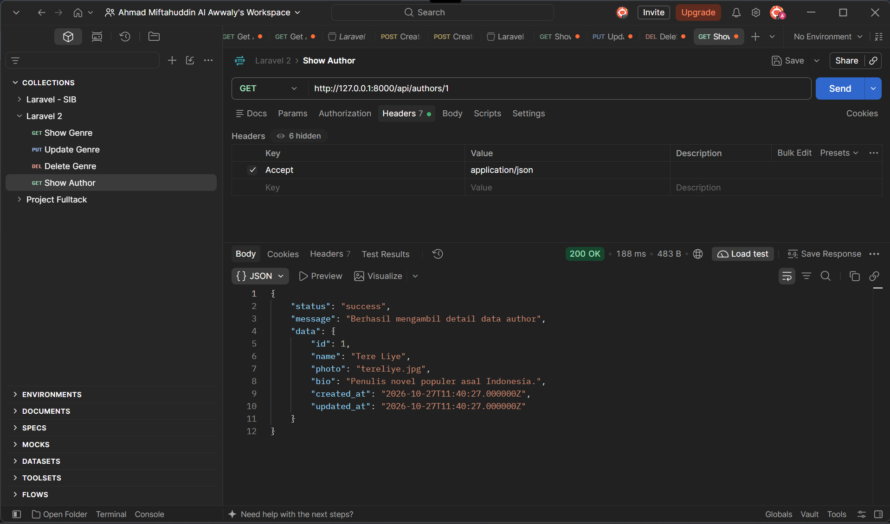

#### 2. Show Author tidak ditemukan (`GET /api/authors/99`) — `404 Not Found`
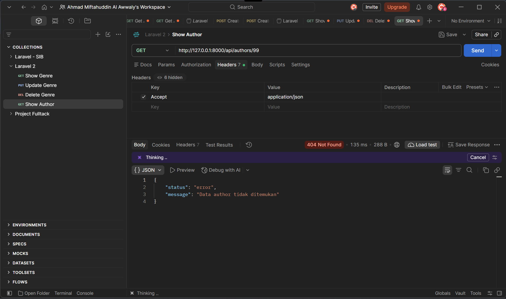

#### 3. Update Author (`PUT /api/authors/6`) — `200 OK`
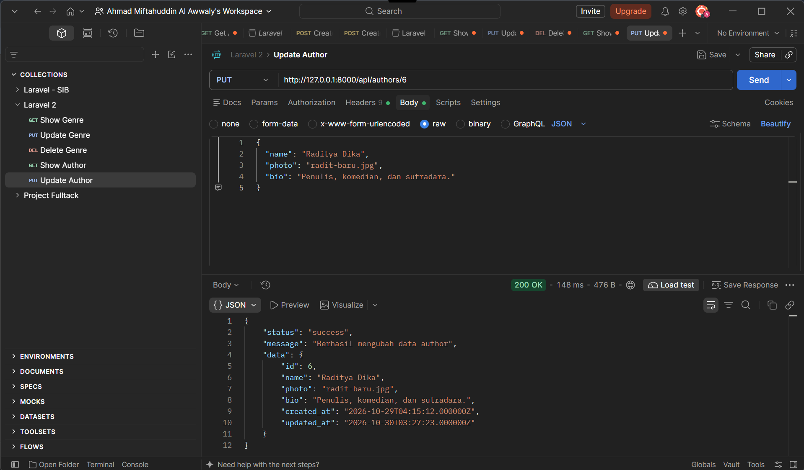

#### 4. Update Author tanpa `name` (`PUT /api/authors/6`) — `422`
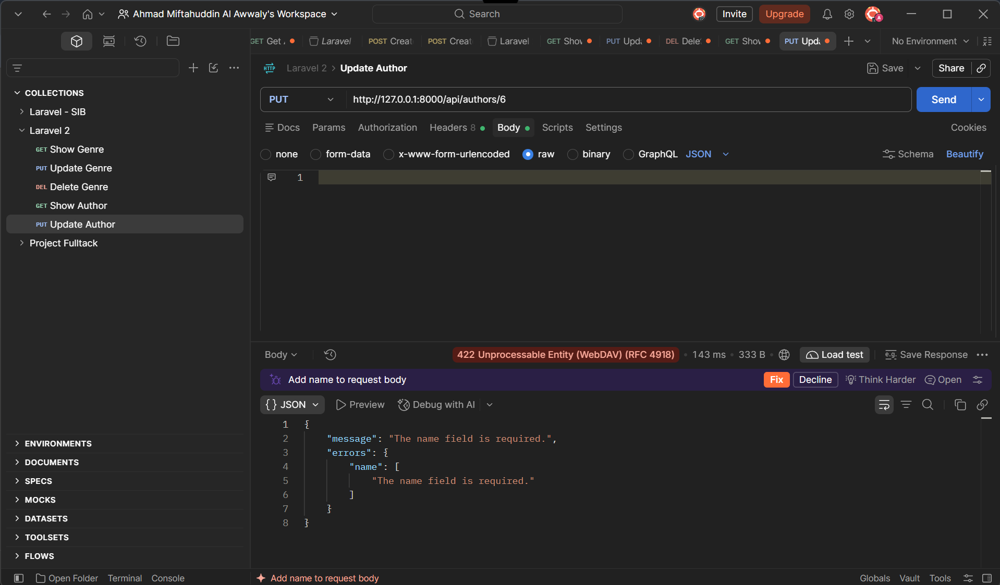

#### 5. Update Author tidak ditemukan (`PUT /api/authors/99`) — `404 Not Found`
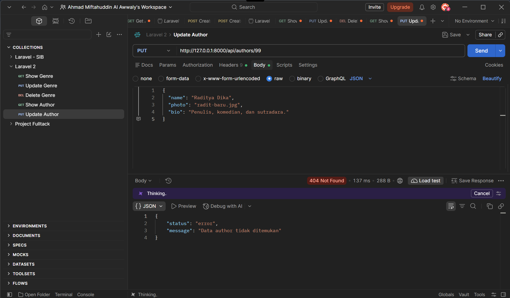

#### 6. Destroy Author (`DELETE /api/authors/6`) — `200 OK`
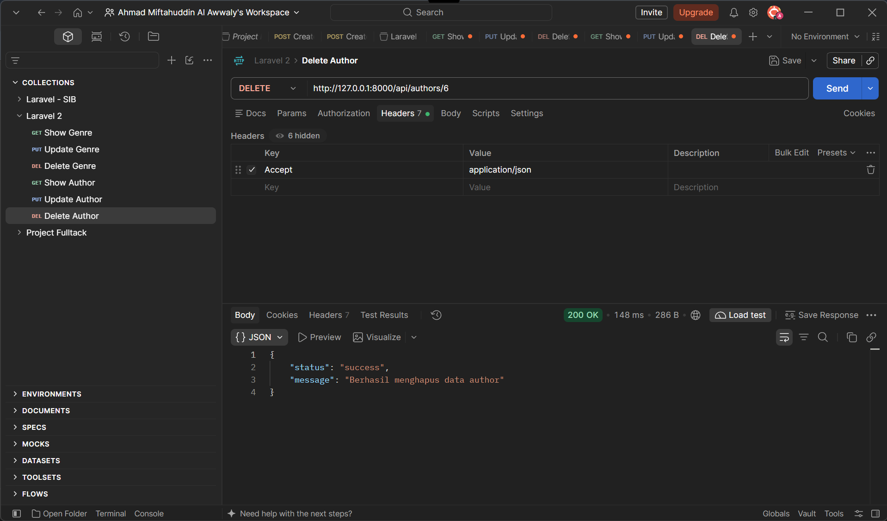

#### 7. Destroy Author yang sudah dihapus (`DELETE /api/authors/6`) — `404 Not Found`
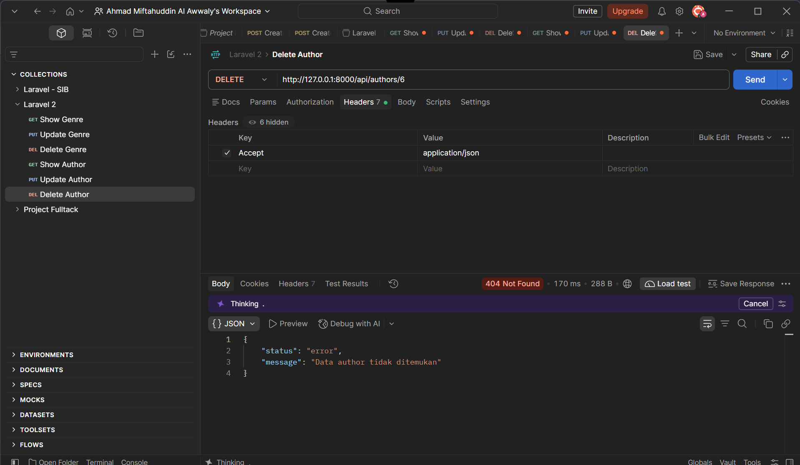