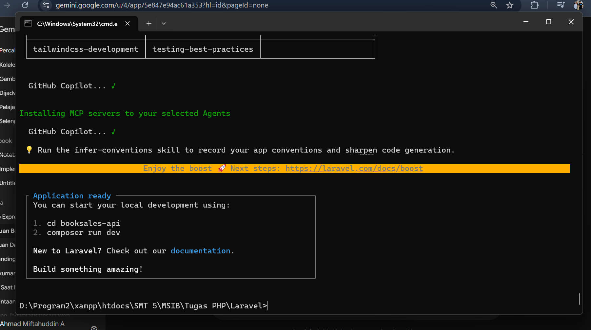
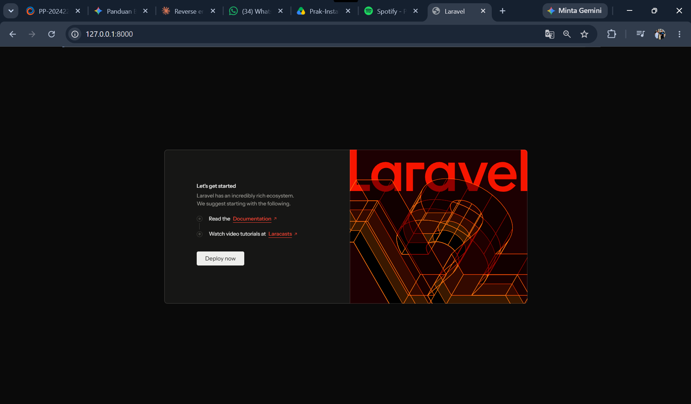

# Laporan Instalasi & Setup Laravel 12 - Booksales API

Dokumen ini berisi catatan langkah-langkah instalasi dan konfigurasi lingkungan kerja Laravel 12 untuk proyek **`booksales-api`**.

## 📋 Prasyarat Lingkungan (Environment)

Sebelum melakukan instalasi Laravel, pastikan perangkat telah terkonfigurasi dengan:

* **XAMPP** (PHP versi 8.2+ dan MySQL Service aktif).
* **Composer** (Package Manager PHP).
* Ekstensi `extension=zip` pada file `php.ini` **sudah diaktifkan sebelumnya** dari sesi instalasi Laravel terdahulu.

## 🚀 Langkah-Langkah Instalasi

### 1. Instalasi Laravel Installer (Global)

Menginstal installer global Laravel menggunakan Composer agar CLI perintah `laravel` terdaftar dan dapat digunakan di sistem:

```bash
composer global require laravel/installer
```

Verifikasi versi installer yang berhasil terpasang:

```bash
laravel --version
# Output: Laravel Installer 5.32.0
```

### 2. Membuat Proyek Baru `booksales-api` (Laravel 12)

Proyek dibuat menggunakan perintah `laravel new` di dalam direktori kerja:

```bash
cd "D:\Program2\xampp\htdocs\SMT 5\MSIB\Tugas PHP\Laravel"
laravel new booksales-api
```



**Alur Konfigurasi & Opsi Saat Instalasi (Laravel 12):**

1. **Starter Kit:** `No` / `None`
2. **Testing Framework:** `Pest`
3. **Frontend Stack:** `Blade`
4. **Database Selection:** Pada versi installer terbaru ini, prompt pemilihan database **dilewati secara otomatis** (*auto-configured* via `.env`).
5. **AI Boost Integration:** Muncul prompt baru bawaan Laravel 12 (*Laravel Boost*) untuk mengonfigurasi AI Agent. Karena opsi ini wajib diisi dan tidak bisa dilewati (*skip*), dipilihlah opsi **GitHub Copilot**.

## 💻 Menjalankan Server Lokal

1. Masuk ke direktori proyek yang baru dibuat:
   ```bash
   cd booksales-api
   ```

2. Buka proyek pada text editor (VS Code):
   ```bash
   code .
   ```

3. Jalankan server lokal Laravel melalui terminal:
   ```bash
   php artisan serve
   ```

4. Buka peramban (browser) dan akses alamat: `http://127.0.0.1:8000`

## 📸 Hasil Instalasi

Tampilan halaman selamat datang (*Welcome Page*) Laravel 12 yang menandakan aplikasi backend berhasil dijalankan dengan lancar:



## 🛠️ Ringkasan Spesifikasi Proyek

| Komponen | Keterangan |
| :--- | :--- |
| **Framework** | Laravel 12.x |
| **Nama Proyek** | `booksales-api` |
| **Database** | MySQL / Auto-configured via `.env` |
| **Environment Server** | PHP Artisan Development Server |