# Booksales API - Tugas Business Process (Transaksi) (REST API Laravel)

Proyek ini merupakan pengembangan lanjutan dari layanan **REST API** Laravel Booksales. Pada tahap ini ditambahkan **bisnis proses transaksi pembelian buku** untuk sumber daya **Transaction**. Alur bisnis dijalankan di sisi server: nomor order dibuat otomatis, identitas pembeli diambil dari token JWT, total harga dihitung dari harga buku, dan stok buku berkurang atau kembali sesuai status transaksi. Hak akses setiap endpoint diatur dengan **middleware** dan **RBAC** (role `admin` dan `customer`).

---

## 🧩 Bisnis Proses Transaksi

Mengacu pada materi *Business Process* (Laravel API), bisnis proses pada tugas ini dipetakan ke komponen Laravel berikut:

| Komponen Laravel | Penerapan pada Tugas |
| :--- | :--- |
| **Routing API** | `routes/api.php` — rute transaksi dipisah per hak akses (login, customer, admin) |
| **Controller API** | `TransactionController` — menangani logika transaksi dan mengembalikan respons JSON |
| **Model & Resource** | Model `Transaction` berelasi dengan `User` dan `Book`; relasi `user` dan `book` ikut tampil di respons |
| **Middleware** | `auth:api` (wajib login) dan `role:admin` (khusus admin) |
| **Validasi** | `book_id` dan `quantity` wajib diisi sebelum transaksi diproses |
| **Response Formatting** | Semua respons memakai format JSON yang konsisten (`status`, `message`, `data`) |

### Alur Bisnis Proses

| Tahap | Aturan |
| :--- | :--- |
| **Input** | Customer mengirim `book_id` dan `quantity` |
| **Validasi** | `book_id` dan `quantity` wajib diisi, jika tidak maka `422` |
| **Pengecekan stok** | Jika `quantity` melebihi stok buku, transaksi ditolak dengan `400` ("Stok buku tidak cukup") |
| **Nomor order** | `order_number` dibuat otomatis oleh sistem dengan format `ORD-XXXXXXXXXXXXX` |
| **Pembeli** | `customer_id` diambil otomatis dari token JWT, tidak dari request |
| **Total harga** | `total_amount` = harga buku × `quantity` (contoh: 95.000 × 2 = 190.000) |
| **Stok** | Stok buku berkurang saat transaksi dibuat, dan kembali saat transaksi dihapus |
| **Output** | Data transaksi beserta relasi `user` dan `book` |

---

## 🚀 Perubahan & Struktur API

1. ### Database (Migration & Model)
   - `create_transactions_table` — Tabel `transactions` berisi `order_number`, `customer_id`, `book_id`, `quantity`, dan `total_amount`.
   - `app/Models/Transaction.php` — Relasi `belongsTo` ke `User` dan `Book`.

2. ### Controller
   - `app/Http/Controllers/TransactionController.php` — Method `index`, `store`, `show`, `update`, dan `destroy`, lengkap dengan validasi, pengecekan stok, dan perhitungan total.

3. ### Routing API
   - `routes/api.php` — Rute transaksi dibagi berdasarkan role: Create, Show, dan Update untuk user yang sudah login, sedangkan Read All dan Destroy khusus admin. Rute `/books` bersifat publik.

   ```php
   // Wajib login (token JWT)
   Route::middleware('auth:api')->group(function () {
       Route::get('/me', [AuthController::class, 'me']);
       Route::post('/logout', [AuthController::class, 'logout']);

       // Transaksi: Create, Show, Update (customer yang sudah login)
       Route::apiResource('/transactions', TransactionController::class)->only(['store', 'show', 'update']);

       // Hanya admin
       Route::middleware('role:admin')->group(function () {
           Route::apiResource('/genres', GenreController::class)->only(['store', 'update', 'destroy']);
           Route::apiResource('/authors', AuthorController::class)->only(['store', 'update', 'destroy']);

           // Transaksi: Read All & Destroy hanya admin
           Route::apiResource('/transactions', TransactionController::class)->only(['index', 'destroy']);
       });
   });

   // Publik
   Route::apiResource('/books', BookController::class);
   ```

---

## 🔐 Akun Pengujian (Seeder)

| Role | Email | Password |
| :--- | :--- | :--- |
| `admin` | `admin@booksales.com` | `admin12345` |
| `customer` | `customer@booksales.com` | `customer12345` |

---

## 📌 Endpoints API

| Method | Endpoint | Deskripsi | Hak Akses | Status Code |
| :--- | :--- | :--- | :--- | :--- |
| `POST` | `/api/transactions` | Membuat transaksi baru | Customer / Admin | `201` / `400` / `401` / `422` |
| `GET` | `/api/transactions/{id}` | Mengambil satu data transaksi | Customer / Admin | `200` / `401` / `404` |
| `PUT` | `/api/transactions/{id}` | Memperbarui transaksi (total menyesuaikan) | Customer / Admin | `200` / `400` / `401` / `404` / `422` |
| `GET` | `/api/transactions` | Mengambil seluruh data transaksi | Admin | `200` / `401` / `403` |
| `DELETE` | `/api/transactions/{id}` | Menghapus transaksi (stok kembali) | Admin | `200` / `401` / `403` / `404` |
| `GET` | `/api/books` | Melihat daftar buku (untuk memeriksa stok) | Publik | `200` |

### Cara Memakai Token

Login terlebih dahulu lewat `POST /api/login`, salin `access_token`, lalu kirim pada header:

```
Authorization: Bearer <access_token>
```

Di Postman: tab **Authorization** → **Bearer Token** → tempel token.

### Format Output JSON

> Isi `message` pada contoh *Create* dapat berbeda dengan implementasimu. Samakan dengan hasil di Postman.

**Create transaksi (`201 Created`)** — `POST /api/transactions` sebagai customer

Request body:

```json
{
  "book_id": 1,
  "quantity": 2
}
```

Respons:

```json
{
  "status": "success",
  "message": "Berhasil menambahkan data transaksi",
  "data": {
    "id": 4,
    "order_number": "ORD-6AEA90825E73E",
    "customer_id": 2,
    "book_id": 1,
    "quantity": 2,
    "total_amount": "190000.00",
    "user": {
      "id": 2,
      "name": "Customer Booksales",
      "email": "customer@booksales.com",
      "role": "customer"
    }
  }
}
```

**Stok tidak cukup (`400 Bad Request`)** — `POST /api/transactions` dengan `quantity` 9999

```json
{
  "status": "error",
  "message": "Stok buku tidak cukup"
}
```

**Validasi gagal (`422 Unprocessable Entity`)** — `POST /api/transactions` dengan body `{}`

Respons berisi pesan bahwa `book_id` dan `quantity` wajib diisi.

**Bukan admin (`403 Forbidden`)** — misalnya `GET /api/transactions` dengan token customer

```json
{
  "status": "error",
  "message": "Akses ditolak. Endpoint ini hanya untuk role: admin"
}
```

**Belum login (`401 Unauthorized`)** — misalnya `POST /api/transactions` tanpa token

```json
{
  "message": "Unauthenticated."
}
```

**Hapus transaksi (`200 OK`)** — `DELETE /api/transactions/4` sebagai admin

```json
{
  "status": "success",
  "message": "Berhasil menghapus data transaksi"
}
```

**Data tidak ditemukan (`404 Not Found`)** — `DELETE /api/transactions/4` yang sudah dihapus

```json
{
  "status": "error",
  "message": "Data transaksi tidak ditemukan"
}
```

---

API dapat diakses di `http://127.0.0.1:8000/api`.

---

## 📸 Pengujian dengan Postman

### 1. Tanpa Login

#### Membuat transaksi tanpa token (`POST /api/transactions`) — `401 Unauthorized`
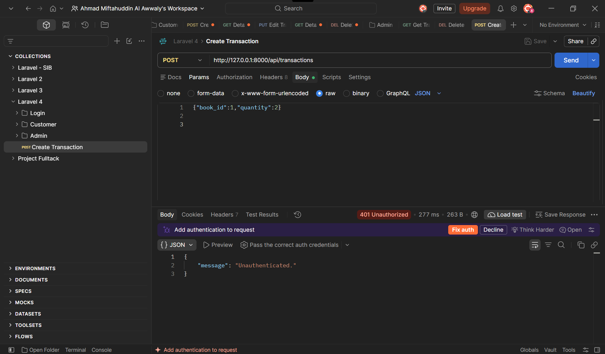

### 2. Login sebagai Customer

#### Login customer (`POST /api/login`) — `200 OK`
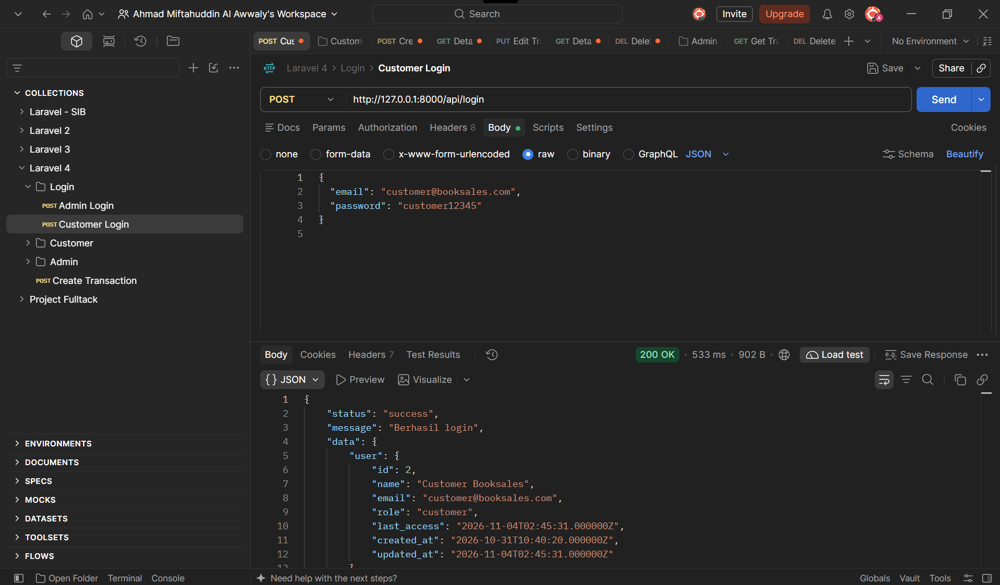

#### Membuat transaksi (`POST /api/transactions`) — `201 Created`
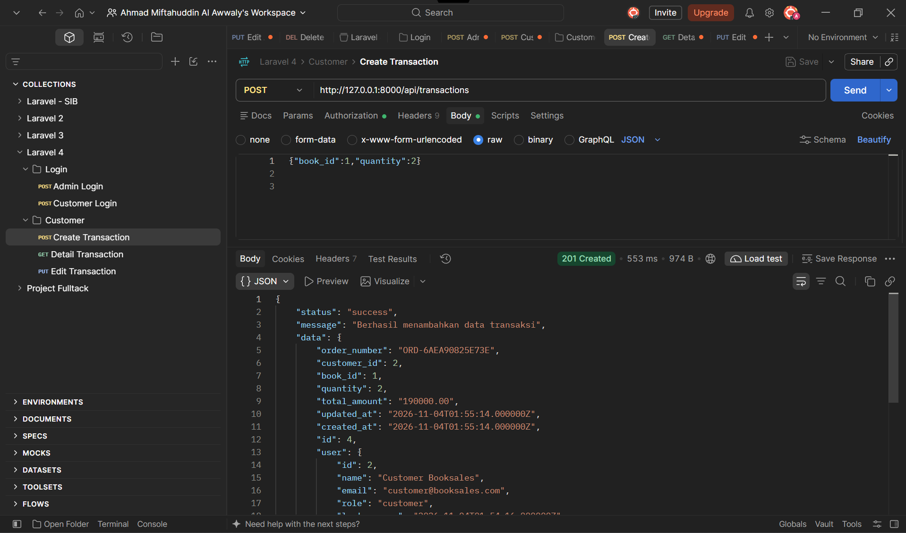

#### Memeriksa stok buku setelah transaksi (`GET /api/books`) — `200 OK`
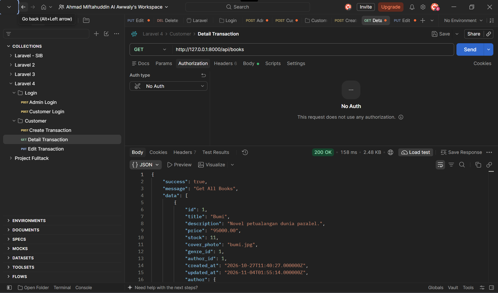

#### Membuat transaksi dengan stok tidak cukup (`POST /api/transactions`, `quantity` 9999) — `400 Bad Request`
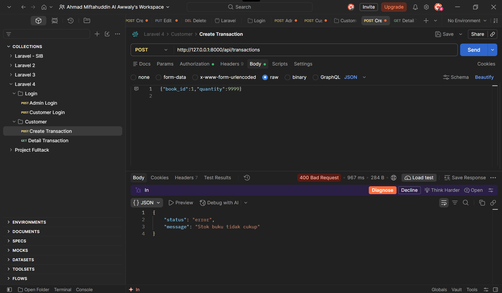

#### Membuat transaksi dengan body kosong (`POST /api/transactions`, `{}`) — `422 Unprocessable Entity`
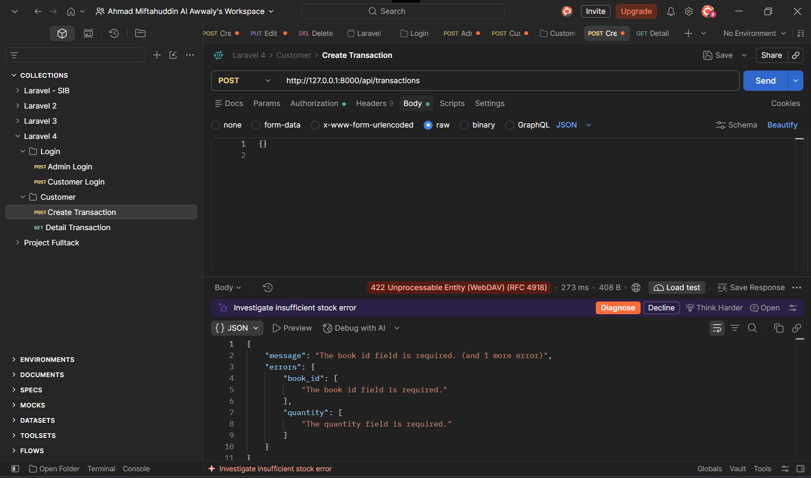

#### Melihat detail transaksi (`GET /api/transactions/4`) — `200 OK`
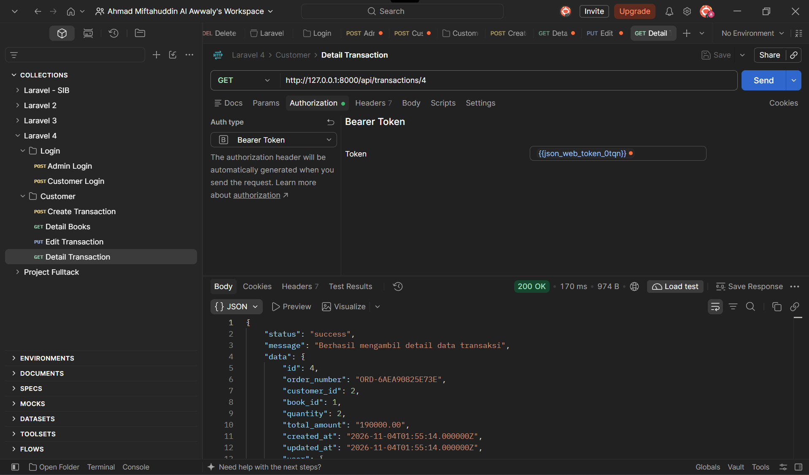

#### Memperbarui transaksi (`PUT /api/transactions/4`, `{"book_id":1,"quantity":5}`) — `200 OK`
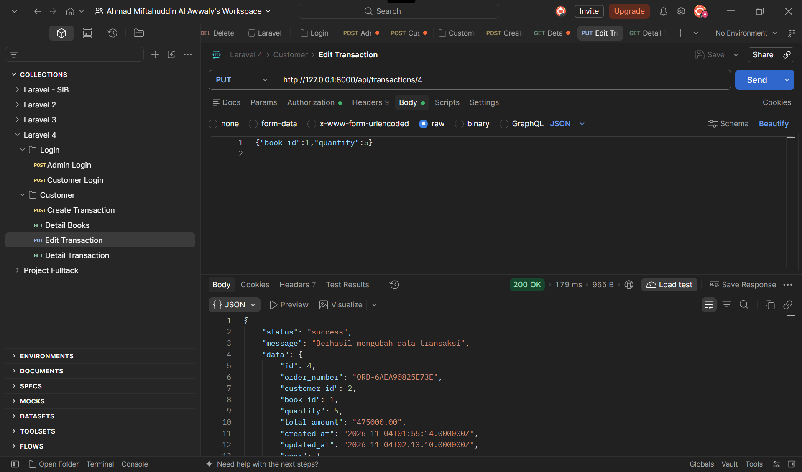

#### Melihat seluruh transaksi (`GET /api/transactions`) — `403 Forbidden`
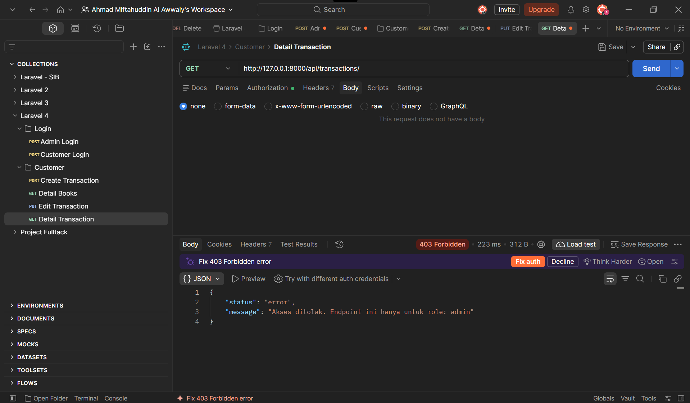

#### Menghapus transaksi (`DELETE /api/transactions/4`) — `403 Forbidden`
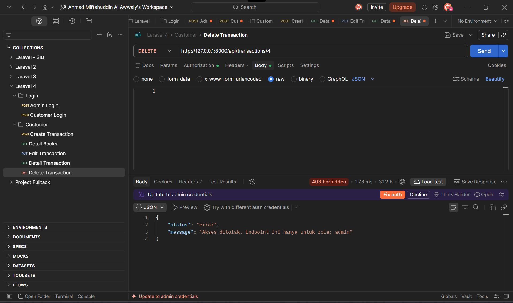

### 3. Login sebagai Admin

#### Login admin (`POST /api/login`) — `200 OK`
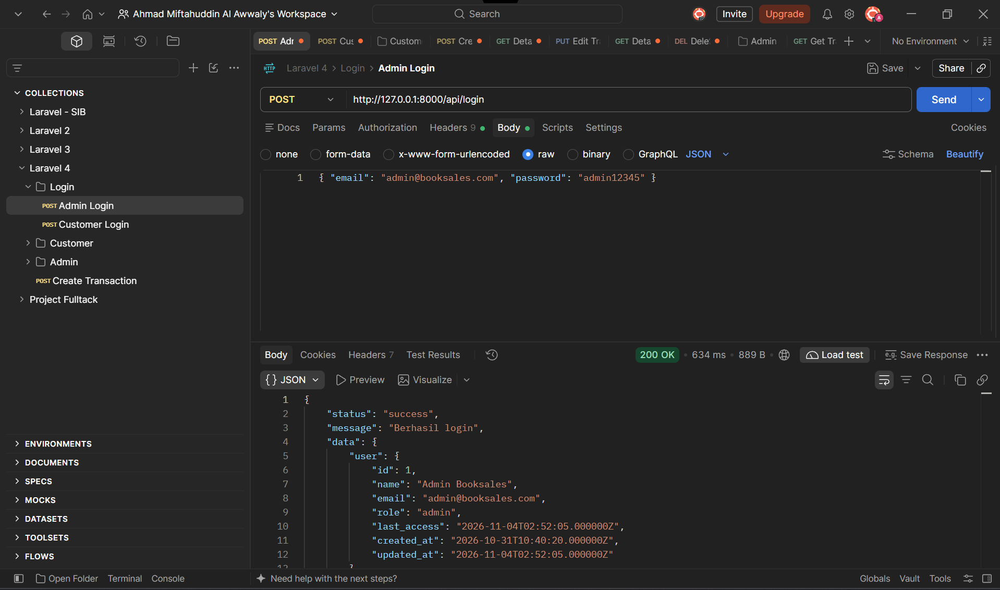

#### Melihat seluruh transaksi (`GET /api/transactions`) — `200 OK`
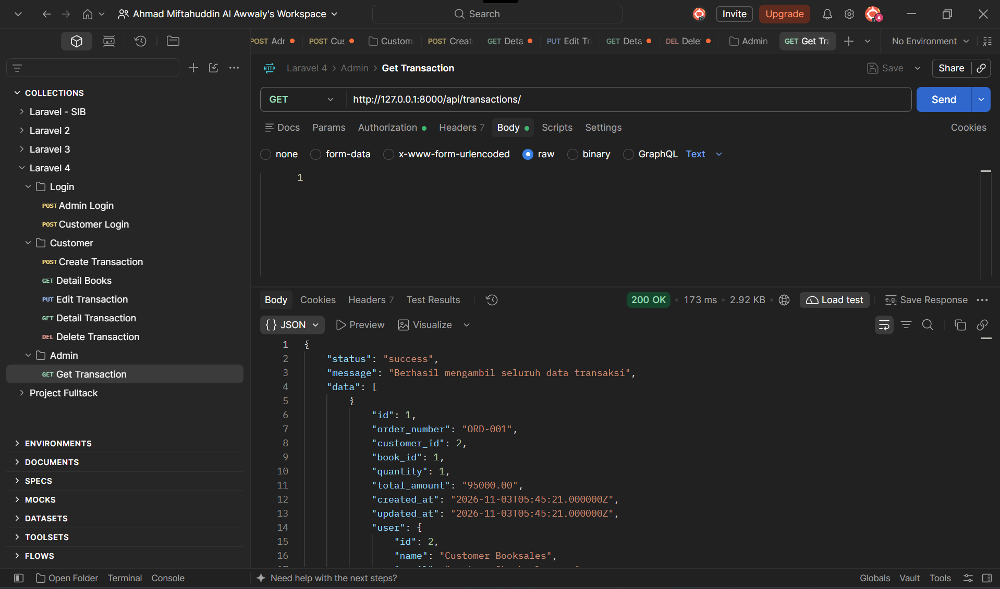

#### Menghapus transaksi (`DELETE /api/transactions/4`) — `200 OK`
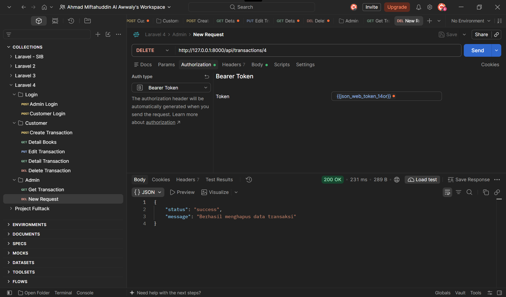

#### Memeriksa stok buku setelah transaksi dihapus (`GET /api/books`) — `200 OK`
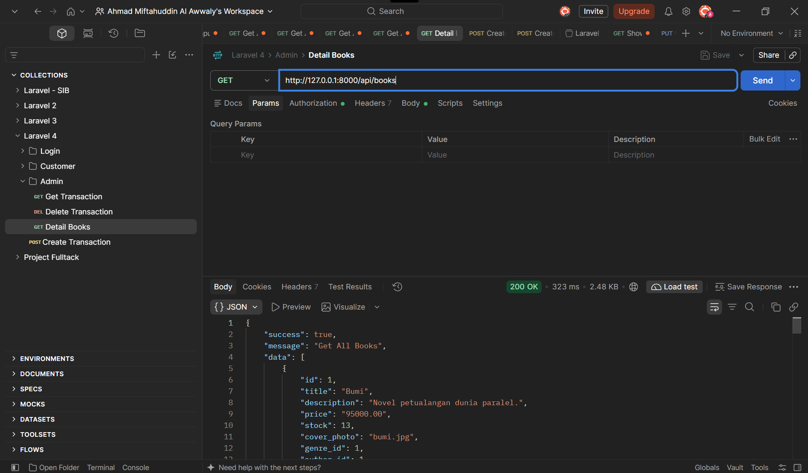

#### Menghapus transaksi yang sudah dihapus (`DELETE /api/transactions/4`) — `404 Not Found`
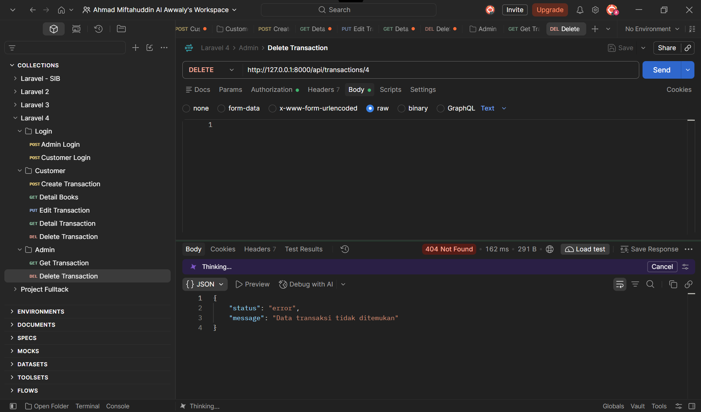