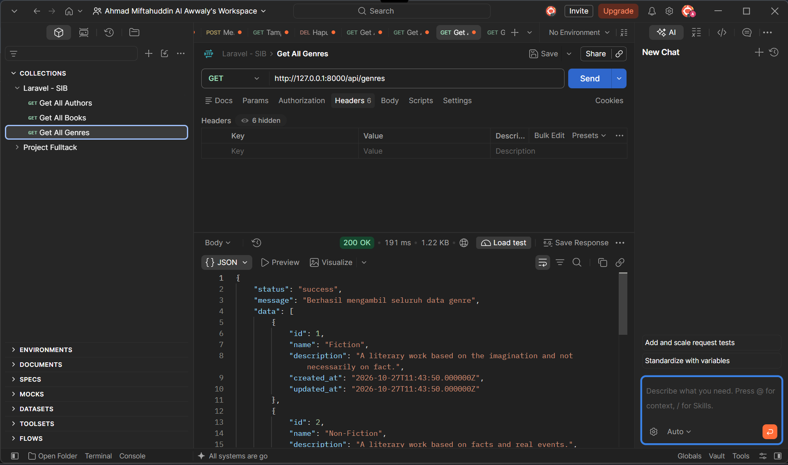
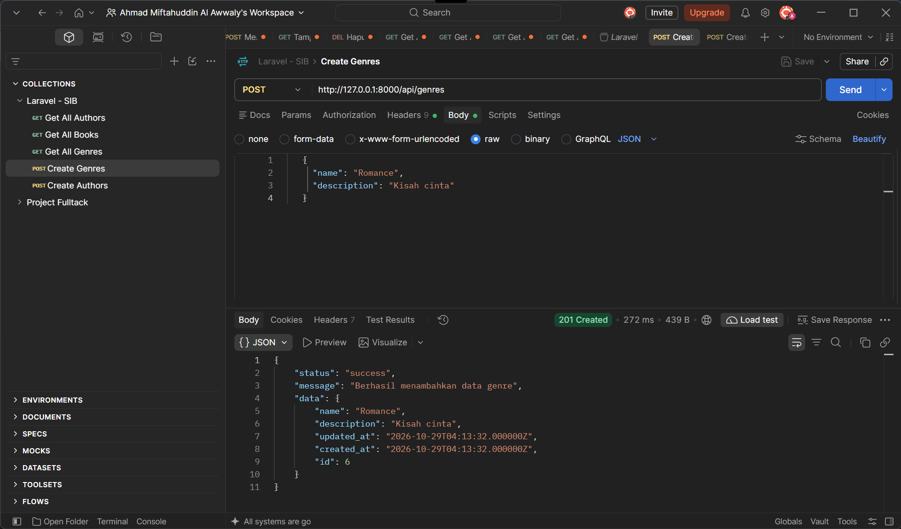
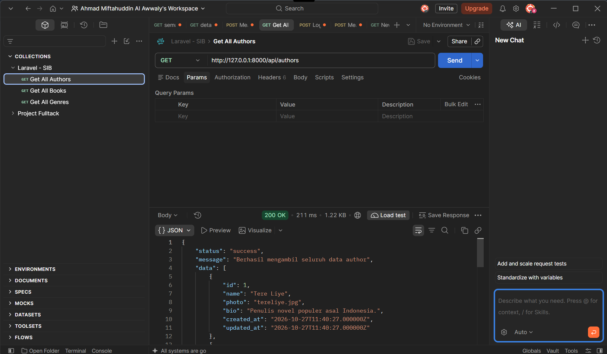
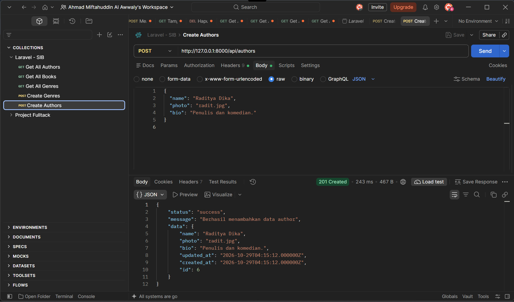

# Booksales API - Tugas Read & Create Data (REST API Laravel)

Proyek ini merupakan pengembangan lanjutan dari layanan **REST API** Laravel. Pada tahap ini ditambahkan fitur **Read** (membaca seluruh data) dan **Create** (menambah data baru) untuk sumber daya **Genre** dan **Author**, lengkap dengan validasi data dan status code HTTP yang sesuai.

---

## 🚀 Perubahan & Struktur API

Berikut adalah penyesuaian utama pada tahap ini:

1. ### Routing API
   - `routes/api.php` — Menambahkan rute `GET` dan `POST` untuk `genres` dan `authors` dengan prefix `/api`.

2. ### Controller (JSON Output)
   - `app/Http/Controllers/GenreController.php` — Method `index()` mengembalikan seluruh data *Genre*, method `store()` memvalidasi lalu menyimpan *Genre* baru.
   - `app/Http/Controllers/AuthorController.php` — Method `index()` mengembalikan seluruh data *Author*, method `store()` memvalidasi lalu menyimpan *Author* baru.

3. ### Model (Eloquent ORM)
   - `app/Models/Genre.php` — Diubah menjadi model Eloquent dengan `$fillable` (`name`, `description`) dan relasi `hasMany` ke *Book*.
   - `app/Models/Author.php` — `$fillable` disesuaikan dengan kolom tabel (`name`, `photo`, `bio`).

4. ### Database (Migration & Seeder)
   - `create_authors_table` — Migrasi tabel `authors` diperbaiki.
   - `create_genres_table` — Migrasi tabel `genres` ditambahkan (dijalankan sebelum tabel `books` karena `books.genre_id` merupakan foreign key).
   - `GenreSeeder` — Seeder data awal genre, dipanggil lebih dulu di `DatabaseSeeder` sebelum `AuthorSeeder` dan `BookSeeder`.

---

## 📌 Endpoints API

| Method | Endpoint | Deskripsi | Status Code |
| :--- | :--- | :--- | :--- |
| `GET` | `/api/genres` | Mengambil seluruh data genre | `200 OK` |
| `POST` | `/api/genres` | Menambahkan data genre baru | `201 Created` / `422 Unprocessable Content` |
| `GET` | `/api/authors` | Mengambil seluruh data penulis (*authors*) | `200 OK` |
| `POST` | `/api/authors` | Menambahkan data penulis baru | `201 Created` / `422 Unprocessable Content` |
| `GET` | `/api/books` | Mengambil seluruh data buku beserta data penulisnya | `200 OK` |

### Aturan Validasi (POST)

| Endpoint | Field | Aturan |
| :--- | :--- | :--- |
| `/api/genres` | `name` | `required`, string, maksimal 255 karakter |
| `/api/genres` | `description` | `nullable`, string |
| `/api/authors` | `name` | `required`, string, maksimal 255 karakter |
| `/api/authors` | `photo` | `nullable`, string, maksimal 255 karakter |
| `/api/authors` | `bio` | `nullable`, string |

> **Catatan:** Tambahkan header `Accept: application/json` pada setiap request agar respons validasi yang gagal berupa JSON (`422`), bukan redirect.

### Format Output JSON

**Read data (`200 OK`)**

```json
{
  "status": "success",
  "message": "Berhasil mengambil seluruh data genre",
  "data": [
    {
      "id": 1,
      "name": "Fiction",
      "description": "A literary work based on the imagination and not necessarily on fact.",
      "created_at": "2026-10-27T11:43:50.000000Z",
      "updated_at": "2026-10-27T11:43:50.000000Z"
    }
  ]
}
```

**Create data (`201 Created`)**

Request body `POST /api/authors`:

```json
{
  "name": "Raditya Dika",
  "photo": "radit.jpg",
  "bio": "Penulis dan komedian."
}
```

Respons:

```json
{
  "status": "success",
  "message": "Berhasil menambahkan data author",
  "data": {
    "name": "Raditya Dika",
    "photo": "radit.jpg",
    "bio": "Penulis dan komedian.",
    "updated_at": "2026-10-29T04:15:12.000000Z",
    "created_at": "2026-10-29T04:15:12.000000Z",
    "id": 6
  }
}
```

---

API dapat diakses di `http://127.0.0.1:8000/api`.

---

## 📸 Pengujian dengan Postman

### 1. Read Genre (`GET /api/genres`)


### 2. Create Genre (`POST /api/genres`)


### 3. Read Author (`GET /api/authors`)


### 4. Create Author (`POST /api/authors`)
