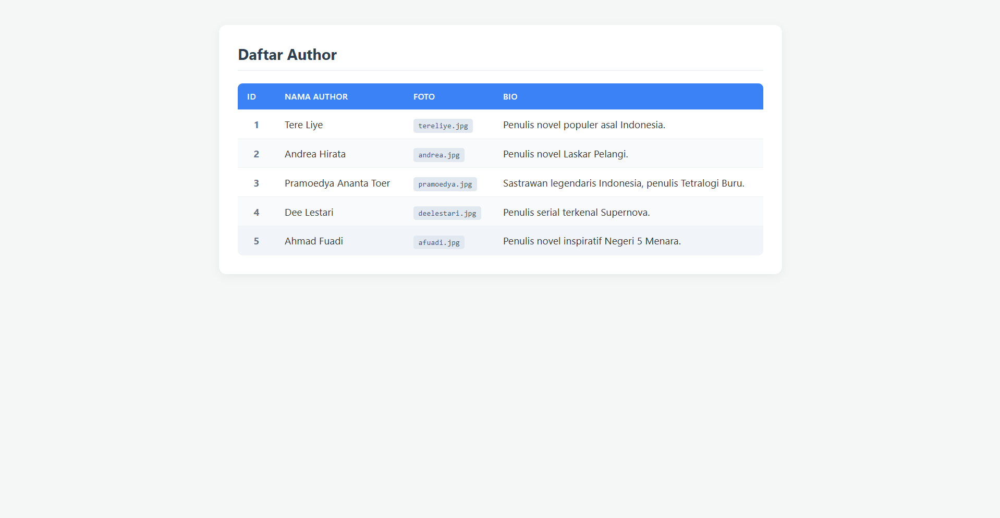
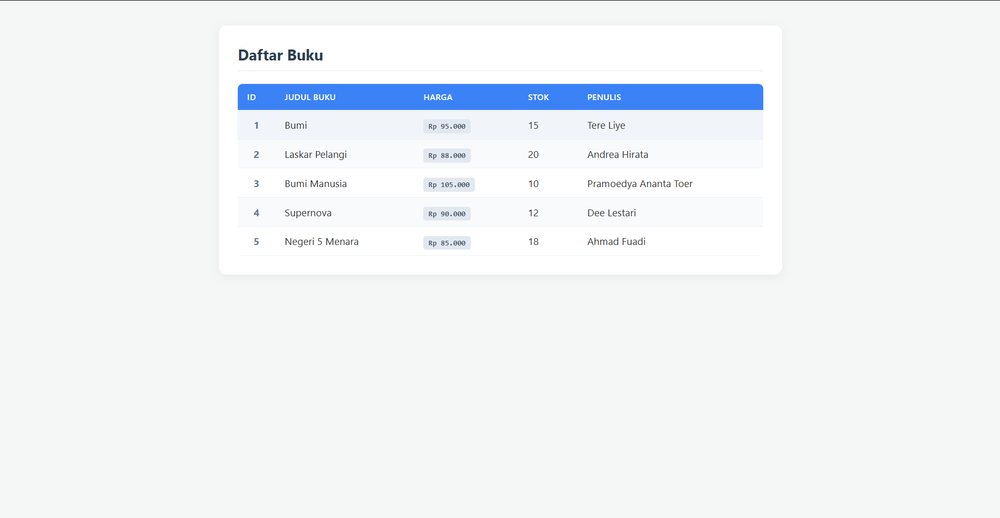

# Booksales API - Tugas Pertemuan 3 (REST API Laravel)

Proyek ini merupakan refactoring dari aplikasi web Laravel berbasis MVC (Blade views) menjadi layanan **REST API**. Aplikasi ini menyajikan data dalam format JSON untuk sumber daya **Author** dan **Book** yang siap dikonsumsi oleh aplikasi frontend atau mobile.

---

## 🚀 Perubahan & Struktur API

Berikut adalah penyesuaian utama pada Pertemuan 2:

1. ### Routing API
   - `routes/api.php` — Semua rute dipindahkan ke file API dengan prefix `/api`.
   - `routes/web.php` — Diperbarui/Dibersihkan dari rute berbasis view.

2. ### Controller (JSON Output)
   - `app/Http/Controllers/AuthorController.php` — Mengembalikan data seluruh *Author* dalam format JSON terstruktur.
   - `app/Http/Controllers/BookController.php` — Mengembalikan data seluruh *Book* beserta relasi *Author*-nya (*Eager Loading*) dalam format JSON.

3. ### Removal of Views
   - Menghapus folder `resources/views/authors/` dan `resources/views/books/` karena aplikasi berfokus penuh sebagai backend API tanpa tampilan Blade.

---

## 📌 Endpoints API

Semua request menggunakan HTTP Method `GET`:

| Method | Endpoint | Deskripsi | Status Code |
| :--- | :--- | :--- | :--- |
| `GET` | `/api/authors` | Mengambil seluruh data penulis (*authors*) | `200 OK` |
| `GET` | `/api/books` | Mengambil seluruh data buku (*books*) beserta data penulisnya | `200 OK` |

### Format Output JSON

```json
{
  "success": true,
  "message": "Get All Authors",
  "data": [
    {
      "id": 1,
      "name": "Tere Liye",
      "photo": "tereliye.jpg",
      "bio": "Penulis novel populer asal Indonesia.",
      "created_at": "2026-10-27T11:40:27.000000Z",
      "updated_at": "2026-10-27T11:40:27.000000Z"
    }
  ]
}   
```

---

## 📸 Pengujian dengan Postman

### 1. Daftar Author (`/api/authors`)


### 2. Daftar Book (`/api/books`)
